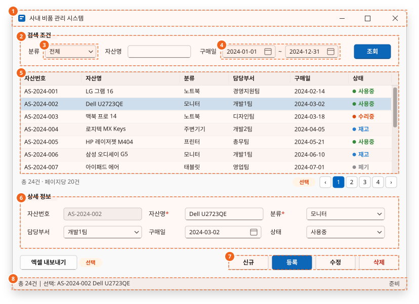
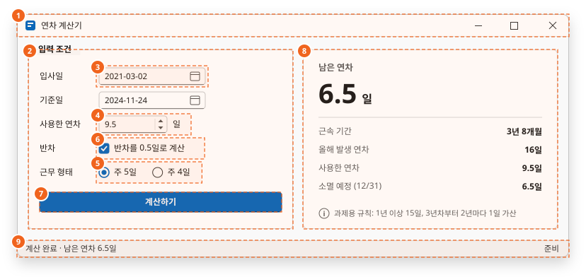
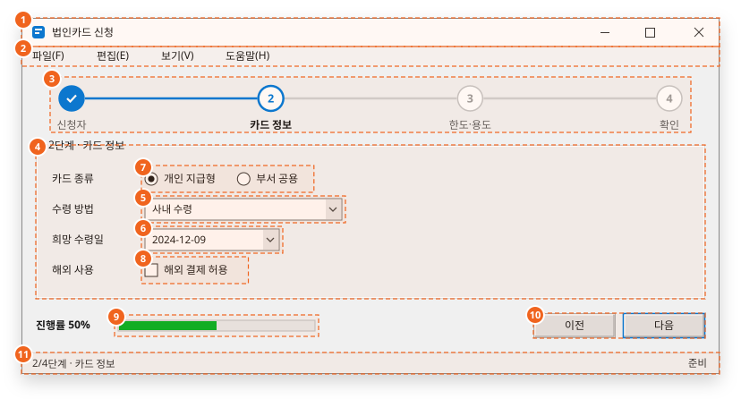
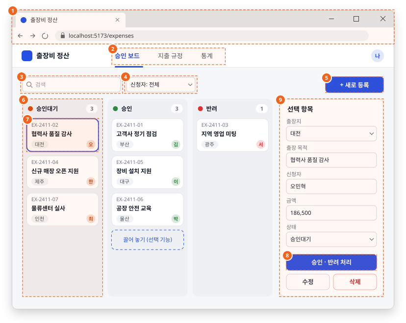
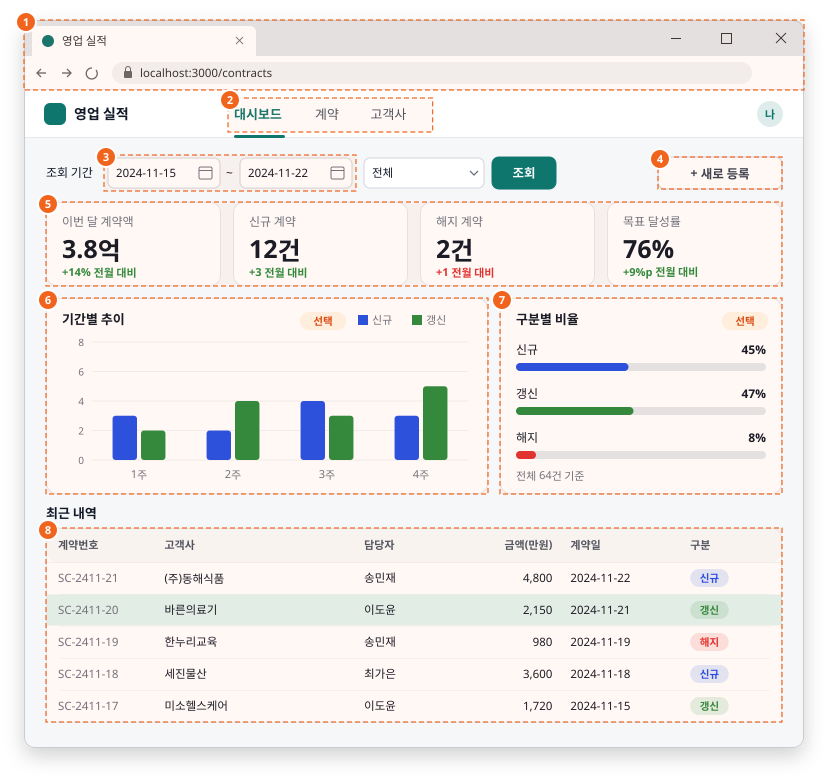
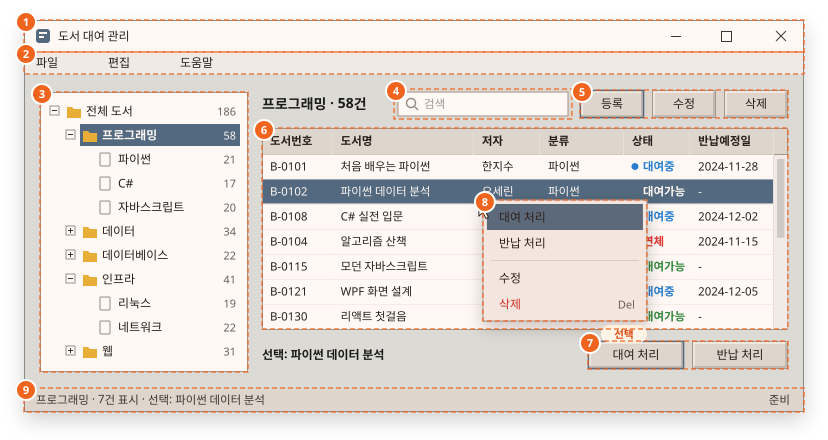

# 신입사원 온보딩 과제 생성기

신입사원이 실무에 들어가기 전에 풀어 볼 **실무형 개발 과제**를 만들어 주는 웹 애플리케이션입니다.
언어/프레임워크와 난이도를 고르면 **상세 개발 명세서 + 구현 목표 예시 화면 + 채점표**가 한 세트로 나옵니다.

> 데모 주소: _(Vercel 배포 후 추가 예정)_ · 기본은 **Mock 모드**라 API 키나 비용 없이 체험할 수 있습니다.

<p align="center">
  
</p>
<p align="center"><sub>C# WPF · 중급 「사내 IT 비품 관리」 예시 화면 — 주황색 번호는 화면의 각 영역에 써야 할 컨트롤 이름</sub></p>

---

## 이런 문제를 풀어요

- 신입에게 줄 과제를 사수가 매번 새로 고민하고, 글로만 설명해서 **완성 모습이 서로 다르게** 나옵니다.
- 과제마다 기준이 달라 **"다 만들었다"와 "잘 만들었다"를 구분하기 어렵습니다.**

이 프로그램은 과제마다 **따라 만들 수 있는 화면 설계도**와 **같은 기준의 채점표**를 함께 줘서, 신입은 목표가 분명해지고 사수는 리뷰 시간이 줄어듭니다.

## 주요 기능

| 기능 | 설명 |
|---|---|
| 과제 생성 | 프레임워크 5종 × 난이도 2단계 × 화면 유형 12종 중에서 과제 아이디어를 제안 |
| 채택 / 넘김 | 마음에 들면 채택, 아니면 넘기고 **직전과 다른 화면 유형**의 새 아이디어 받기 |
| 예시 화면 | 고른 프레임워크의 실제 컨트롤 모양으로 그린 화면. 번호 핀으로 컨트롤 이름(`DataGrid`, `<select />` 등)을 표시하고, 목록·탭·카드는 눌러서 바뀌는 모습 확인 |
| 개발 명세서 | 개요, 필수 컨트롤·기술, 코드 구조(초급: 화면/로직 분리, 중급: 3-tier), 요구사항, 선택 기능, 예외 처리, 데이터 설계 가이드(중급) |
| 채점표 | 필수 100점 + 가산점, 등급 기준 |
| 기록 저장 | 제안 기록과 채택 상태를 브라우저에 저장 (새로고침해도 유지) |
| 내보내기 | 채택한 과제를 **명세서 `.md` + 예시 화면 `.svg`**로 내려받아 신입에게 전달 → [내보내기 예시](docs/images/sample-spec-react-kanban.md) |

## 예시 화면 모음

같은 과제도 프레임워크를 바꾸면 그 플랫폼의 컨트롤과 스타일로 다시 그려집니다.

| 초급 · 계산기형 (C# WPF) | 초급 · 단계형 마법사 (C# WinForm) |
|---|---|
|  |  |
| **중급 · 칸반 보드 (React)** | **중급 · 대시보드 (NodeJS)** |
|  |  |
| **중급 · 트리 + 그리드 (Python Tkinter)** | **중급 · 그리드 + 상세 폼 (C# WPF)** |
|  |  |

주황색 **"선택"** 배지는 가산점용 편의 기능(드래그 앤 드롭, 차트, 엑셀 내보내기, 우클릭 메뉴 등)입니다. 필수 기능은 이것 없이도 완성할 수 있게 설계되어 있습니다.

## 지원 범위

| 구분 | 내용 |
|---|---|
| 언어 / 프레임워크 | C# WPF (MVVM 필수) · C# WinForm · React · Python (Tkinter) · NodeJS (Express + EJS) |
| 초급 | CRUD·DB 없이 컨트롤과 이벤트 연습 — 입력 폼, 계산기, 체크리스트, 탭 설정, 단계형 마법사, 검색 + 상세 조회 |
| 중급 | DB를 직접 설계하는 실무 CRUD, 3-tier 구조 — 그리드 + 폼, 마스터-디테일, 칸반, 주간 캘린더, 대시보드, 트리 + 그리드 |
| 권장 일정 | 초급 2개 + 중급 1개, 약 2주 |
| 샘플 과제 | 36개 (화면 유형마다 3개) |

## 동작 모드

| 모드 | 설정 | 비용 | 과제 |
|---|---|---|---|
| **Mock** (기본) | `USE_MOCK=true` | 없음 | 준비된 샘플 36개에서 겹치지 않게 제안 |
| **Claude API** | `USE_MOCK=false` + `ANTHROPIC_API_KEY`, `ANTHROPIC_MODEL` | 생성할 때마다 API 요금 | Claude가 매번 새 과제를 생성 (구조화 출력 → 스키마 검증 → 1회 재시도) |

과제의 업무 내용만 Claude가 만들고, 채점 배점·코드 구조·컨트롤 이름처럼 규칙이 정해진 부분은 서버가 카탈로그로 채웁니다. 그래서 어떤 모드든 결과가 같은 규칙을 지킵니다.

## 빠른 시작

```bash
npm install              # Node 22.12 이상
cp .env.example .env     # 처음 한 번 (Mock 모드는 키 없이 동작)
npm run dev              # http://localhost:5173
```

| 명령 | 설명 |
|---|---|
| `npm run dev` | 개발 서버 (화면 5173 + API 3001) |
| `npm test` | 전체 테스트 (스키마·조립기·서버·렌더러 180개 조합·내보내기) |
| `npm run build` → `npm start` | 배포 모드: 서버 하나로 화면 + API |

명령어 전체 목록은 [CLAUDE.md](CLAUDE.md#명령어)에 있습니다.

## 배포

- **Vercel**: 이 저장소를 Vercel에 Import → Deploy. 설정(`vercel.json`)이 들어 있어 따로 바꿀 값이 없고, 환경 변수를 넣지 않으면 Mock 모드로 동작합니다. → [03_architecture#vercel-배포](docs/03_architecture.md#vercel-배포)
- **사내 서버**: `npm ci && npm run build && npm start` → [03_architecture#배포](docs/03_architecture.md#배포)

> ⚠️ 공개 주소에서 Claude API 모드를 켜면 누구나 생성 버튼을 눌러 비용이 나갈 수 있습니다. API 모드를 켜기 전에 접속 제한을 먼저 설정하세요.

## 기술 스택

- **웹**: React 19 · Vite 7 · Tailwind CSS 4 · TypeScript (외부 CDN·웹폰트 없음, 사내망 대비)
- **서버**: Express 5 · zod 4 · Claude Messages API (fetch, 도구 강제 사용으로 구조화 출력)
- **공유 패키지**: 과제 스키마·카탈로그·조립기를 웹과 서버가 함께 사용 (npm workspaces)
- **테스트**: Vitest · Supertest

```
apps/web         화면 (컨트롤 바, 결정 바, 명세서, 예시 화면 렌더러, 내보내기)
apps/server      API (/api/health, /api/assignments) — Mock / Claude 생성기
packages/shared  과제 스키마(zod) · 카탈로그(프레임워크·화면 유형·규칙) · 조립기
fixtures         샘플 과제 36개 (Draft 형식)
docs             기획·설계 문서 (아래 문서 지도)
```

---

## 문서 지도

**한 가지 내용은 한 문서에만** 적습니다. 무엇을 바꾸려는지에 따라 아래 표에서 고칠 문서를 찾으세요.

| 문서 | 담당하는 내용 | 이런 변경이 생기면 여기를 수정 |
|---|---|---|
| [00_roadmap](docs/00_roadmap.md) | 개발 단계, 단계별 작업과 완료 기준 | 일정·진행 순서 변경 |
| [01_product](docs/01_product.md) | 목적, 사용자, 범위(MVP/백로그), 용어 | 기능을 넣거나 뺄 때 |
| [02_ui-spec](docs/02_ui-spec.md) | 화면 영역, 버튼 동작, 제안 상태 흐름, 내보내기 | 화면·상호작용 변경 |
| [03_architecture](docs/03_architecture.md) | 기술 스택, 폴더 구조, 데이터 흐름, 내부 API, 배포 | 기술 선택·구조 변경 |
| [04_assignment-schema](docs/04_assignment-schema.md) | 과제 데이터(JSON) 형식과 검증 규칙 | 과제에 항목을 추가·변경할 때 |
| [05_assignment-rules](docs/05_assignment-rules.md) | 난이도 정의, 필수/선택 원칙, 코드 구조 원칙, 채점 배점, 소요 기간 | 과제 **정책** 변경 |
| [06_frameworks](docs/06_frameworks.md) | 언어/프레임워크별 기술·힌트·폴더 템플릿·컨트롤 이름 | 프레임워크 추가·수정 |
| [07_layouts](docs/07_layouts.md) | 화면 유형 12종의 구성과 필수/선택 기능 | 화면 유형 추가·수정 |
| [08_prompt](docs/08_prompt.md) | Claude API 프롬프트, 출력 검증, 재시도 | 생성 품질 개선 |
| [09_decisions](docs/09_decisions.md) | 지금까지의 결정과 이유 | 정책·구조를 바꿀 때 기록 추가 |

기획 단계에서 만든 UI 목업은 [`mockup/onboarding-mockup.html`](mockup/onboarding-mockup.html)에 있습니다 (참고용, 기준은 문서). 작업 방법(Claude·개발자 공통 지침)은 [`CLAUDE.md`](CLAUDE.md)에 있습니다.

## 문서 관리 규칙

1. **단일 출처**: 같은 사실을 두 문서에 쓰지 않습니다. 필요하면 링크로 가리킵니다.
   - 예) 채점 배점은 05에만 있고, 02·08은 "05 참고"라고만 씁니다.
2. **정책을 바꿀 때**: 해당 문서를 고치고, [09_decisions](docs/09_decisions.md)에 결정 기록을 한 줄 추가합니다.
3. **데이터 형식을 바꿀 때**: [04](docs/04_assignment-schema.md)를 먼저 고친 뒤 코드를 고칩니다.
4. **카탈로그(06·07)와 코드**: 문서가 기준입니다. 코드의 카탈로그 상수(`packages/shared/src/catalog`)는 문서를 옮긴 것이므로, 둘을 함께 수정합니다.
5. 각 문서 맨 위의 **최종 수정일**을 갱신합니다.
6. README의 예시 화면(`docs/images/*.svg`)은 렌더러 출력물입니다. 화면 모양을 바꾸면 테스트가 `.runner/out/export-samples/`에 만드는 파일로 다시 교체합니다.
