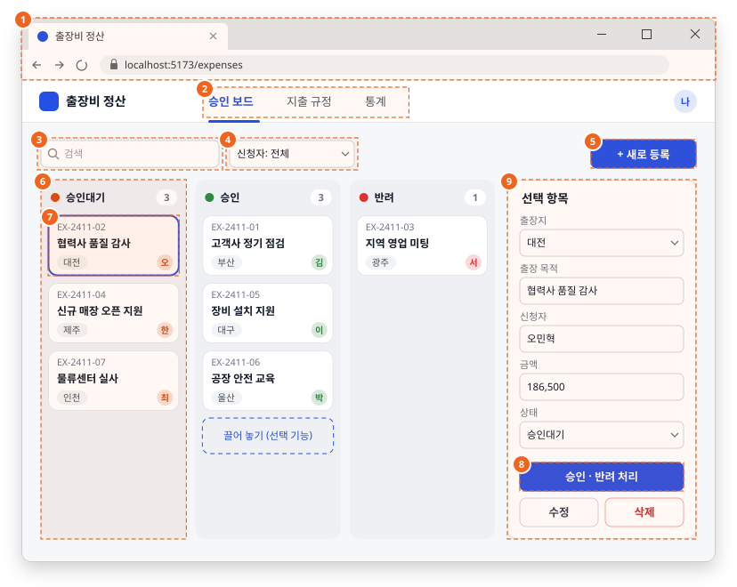

# 출장비 정산 승인 관리

> React · 중급 (실무 CRUD 과제 · DB 연동) · 화면 유형: 칸반 보드 · 예상 소요: 4~5일
> 요청 부서 예시: 재무팀

## 1. 과제 개요

재무팀은 출장비 정산을 이메일로 받아 어떤 요청이 어디까지 처리됐는지 알기 어렵습니다. 요청을 승인 단계별 보드로 보고, 카드를 옮겨 승인·반려할 수 있어야 합니다. 이를 React 화면과 Mock API(json-server)로 구현합니다.

- **학습 목표**: 상태별 그룹핑, 카드 선택, 상태 이동, 상세 패널 동기화
- **산출물**: GitHub 저장소 + README + 시연 영상(3분)

## 2. 구현 목표 예시 화면

> 화면 그림은 같은 폴더의 `intermediate-kanban-react.svg` 파일입니다.

화면 번호별 컨트롤:

1. `<App /> (Vite)` — localhost:5173/expenses
2. `<NavBar />` — 상단 메뉴
3. `<input />` — 검색
4. `<select />` — 담당자 필터
5. `<button />` — 등록
6. `<KanbanColumn /> ×3` — 상태별 열
7. `<Card />` — 항목 카드 (클릭)
8. `<button />` — 다음 단계로 이동
9. `<fieldset> / Card` — 선택 카드 상세

## 3. 필수 사용 컨트롤 · 핵심 기술

- **컨트롤**: `<App /> (Vite)`, `<input />`, `<select />`, `<button />`, `<KanbanColumn /> ×3`, `<Card />`, `<fieldset> / Card`
- **기술**: 3-tier 구조, useEffect + fetch, json-server Mock API, 컴포넌트 분리 / props, React Hook Form + Zod, TanStack Query, 커스텀 훅

## 4. 코드 구조 · 3-tier 구조

- **Presentation** (화면 표시·입력, 사용자 이벤트): `src/pages/ExpensePage.jsx`, `src/components/Expense*.jsx`
- **Business** (업무 규칙·검증·트랜잭션): `src/hooks/useExpenses.js`, `src/services/expenseService.js`
- **Data** (저장·조회만 담당): `src/api/expenseApi.js`, `db.json (json-server)`
- **공통 모델**: `src/constants/expense.js`

지켜야 할 규칙:

- 컴포넌트 안에서 fetch를 직접 호출하지 않음
- "출장지별 일비 한도 초과 시 경고" 같은 업무 규칙은 Business 계층에 구현
- Data 계층은 저장·조회만 담당하고, 바꿔 끼울 수 있게 분리
- 의존 방향은 위에서 아래로 한 방향, 계층 간에는 모델/DTO로 전달

> React는 프론트엔드 안에서의 계층 분리예요. 실제 DB 역할은 json-server가 맡습니다.

## 5. 기능별 CRUD 요구사항 (필수)

이 항목만 완성하면 과제 통과 기준을 채울 수 있습니다.

### R. 조회 / 검색

- 열 상단에 건수 표시
- 신청자 검색과 출장지 필터
- useEffect로 목록 조회, 필터는 controlled input 상태로 관리
- TanStack Query로 캐싱·로딩·에러 상태 처리

### C. 신규 등록

- 요청번호 자동 생성, 상태는 "승인대기"로 시작
- 출장지별 일비 한도 초과 시 경고
- POST 성공 후 목록 갱신과 토스트
- React Hook Form + Zod로 폼 검증

### U. 수정

- [승인]·[반려] 버튼으로 상태 변경, 반려 시 사유 입력 대화상자
- "승인대기" 상태일 때만 내용 수정 가능
- 승인/반려 시 사유 입력 필수
- PUT 요청, 키 입력란은 disabled
- 저장 중 버튼 비활성화, 실패 시 오류 표시

### D. 삭제

- "승인대기" 요청만 삭제 가능
- 반려 건은 삭제 대신 보관
- 확인 모달 승인 후 DELETE 요청
- 삭제 후 invalidateQueries로 목록 갱신

## 6. 선택 기능 (가산점)

필수 기능을 모두 끝낸 뒤 시간이 남으면 도전합니다.

- 카드 드래그 앤 드롭으로 상태 변경
- 열 상단에 금액 합계 표시
- 낙관적 업데이트 (실패 시 롤백)
- 필터 상태를 URL 쿼리스트링과 동기화

## 7. 예외 처리 조건

- 금액은 0보다 큰 숫자만 허용
- 출장일이 미래면 정산 요청 불가
- 금액 1,000만 원 초과 시 추가 확인
- API 실패 시 오류 배너와 재시도 버튼, 응답 지연 시 스켈레톤 표시

## 8. 데이터 설계 가이드

DB 테이블과 API는 정해 주지 않습니다. 아래 질문에 답하며 직접 설계하고, 설계 이유를 설명할 수 있어야 합니다.

1. 화면 항목(요청번호, 출장지, 출장 목적, 신청자, 금액, 상태)을 출발점으로, 필요한 테이블과 컬럼을 정해 보기
2. 업무 코드(예: EX-2411-01)와 내부 기본키를 따로 둘지 정하고 이유 적기
3. 상태값을 코드 테이블로 둘지, CHECK 제약으로 둘지 비교하기
4. 등록일시·수정일시·작성자 같은 공통 컬럼 넣기
5. 승인·반려 이력(누가, 언제, 사유)을 별도 테이블로 남기기
6. API를 URL·메서드·요청/응답 예시·상태 코드 표로 먼저 정리하기

**제출물**: README에 ERD와 "왜 이렇게 설계했는지" 3줄 이상 정리

## 9. 채점표

| 구분 | 항목 | 배점 |
|---|---|---:|
| 기능 (CRUD) | 조회 / 검색: 열 상단에 건수 표시 | 8 |
| 기능 (CRUD) | 신규 등록: 요청번호 자동 생성, 상태는 "승인대기"로 시작 | 8 |
| 기능 (CRUD) | 수정: [승인]·[반려] 버튼으로 상태 변경, 반려 시 사유 입력 대화상자 | 7 |
| 기능 (CRUD) | 삭제: "승인대기" 요청만 삭제 가능 | 7 |
| 3-tier 구조 | 컴포넌트 안에서 fetch를 직접 호출하지 않음 | 8 |
| 3-tier 구조 | 업무 규칙("출장지별 일비 한도 초과 시 경고")이 Business 계층에 있음 | 7 |
| 3-tier 구조 | Data 계층이 분리되어 교체 가능 | 5 |
| 3-tier 구조 | 계층 간 모델/DTO로 전달 | 5 |
| 데이터 설계 | db.json 구조와 설계 이유를 README에 정리 | 5 |
| 데이터 설계 | 필수값·중복 방지를 DB 제약으로도 반영 | 5 |
| 데이터 설계 | 날짜·금액 등 타입 선택이 적절함 | 5 |
| 예외·검증 | 금액은 0보다 큰 숫자만 허용 | 5 |
| 예외·검증 | 출장일이 미래면 정산 요청 불가 | 5 |
| 예외·검증 | 금액 1,000만 원 초과 시 추가 확인 | 5 |
| 코드 품질·제출 | 네이밍과 메서드 길이가 적절함 | 5 |
| 코드 품질·제출 | Business 계층 단위 테스트 2개 이상 | 5 |
| 코드 품질·제출 | 기능 단위 커밋과 PR 설명 작성 | 5 |
| **합계** | | **100** |

가산점:

| 구분 | 항목 | 배점 |
|---|---|---:|
| 가산점 (선택 기능) | 카드 드래그 앤 드롭으로 상태 변경 | +5 |
| 가산점 (선택 기능) | 열 상단에 금액 합계 표시 | +5 |
| 가산점 (선택 기능) | 낙관적 업데이트 (실패 시 롤백) | +5 |
| 가산점 (선택 기능) | 필터 상태를 URL 쿼리스트링과 동기화 | +5 |

등급: 90점 이상 A · 우수 / 75점 이상 B · 통과 / 60점 이상 C · 보완 후 통과 / 60점 미만 재제출

---

온보딩 과제 생성기로 만든 과제입니다 · 2026-11-25
